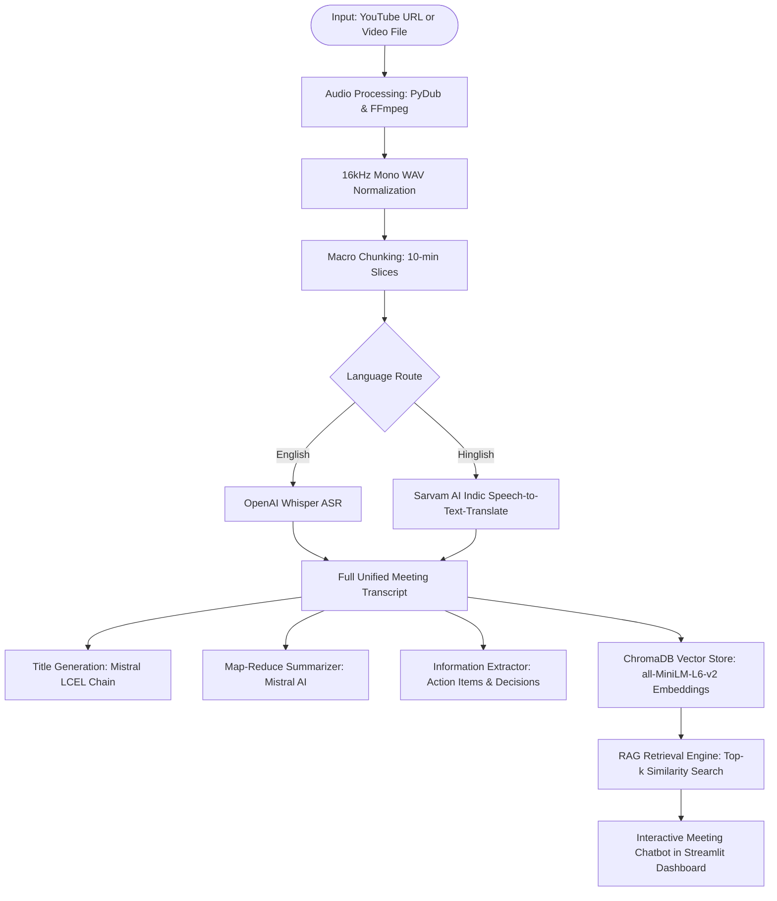

# 🎬 AI Video Assistant · Multimodal Meeting Intelligence & RAG System

[](https://www.python.org/)
[](https://pytorch.org/)
[](https://github.com/openai/whisper)
[](https://mistral.ai/)
[](https://www.trychroma.com/)
[](https://www.langchain.com/)
[](https://streamlit.io/)

> An end-to-end multimodal meeting intelligence platform. Automatically transcribes audio and video (YouTube URLs or local recordings), translates Indic/Hinglish speech via Sarvam AI, performs Map-Reduce summarization with Mistral AI, extracts action items and decisions, and builds an interactive RAG vector store for semantic question-answering.

---

## 🌟 Architecture & Workflow Pipeline

The system is organized into a sequential ingestion, transcription, synthesis, and retrieval pipeline:



### Core Components:
1. **Audio Ingestion & Preprocessing (`utils/audio_processor.py`)**:
   - `yt-dlp` extracts audio from YouTube streams.
   - `pydub` and `FFmpeg` normalize audio into 16kHz mono linear PCM WAV (Whisper's native format) and slice into 10-minute macro blocks.
2. **Dual-Engine Speech Recognition (`core/transcriber.py`)**:
   - **English**: Local OpenAI Whisper model with singleton weight caching.
   - **Hinglish/Indic**: Sarvam AI (`saaras:v2.5`) speech-to-text-translation API with 25-second micro-chunking to respect API payload limits.
3. **Map-Reduce Summarization (`core/summarizer.py`)**:
   - Chunks transcripts using `RecursiveCharacterTextSplitter` (3000 chars, 200 overlap).
   - Summarizes each chunk in parallel (Map) and synthesizes a final executive summary in bullet points (Reduce).
4. **Structured Information Mining (`core/extractor.py`)**:
   - Zero-shot extraction of **Action Items** (Task, Owner, Deadline), **Key Decisions**, and **Open Questions**.
5. **Vector Search & RAG Chat (`core/vector_store.py` & `core/rag_engine.py`)**:
   - Embeds transcript chunks using `sentence-transformers/all-MiniLM-L6-v2`.
   - Stores dense vectors in a persistent ChromaDB HNSW index.
   - Wires semantic retrieval to Mistral AI via LangChain Expression Language (LCEL) with strict grounding constraints.
6. **Cyberpunk Dark Theme Dashboard (`app.py`)**:
   - Real-time pipeline step monitoring with pulsating status dots, transcript viewers, executive summary cards, and an interactive Q&A chat.

---

## 🚀 Key Capabilities

- **Multimodal Ingestion**: Supports direct YouTube URLs and local audio/video file formats (`.mp4`, `.mkv`, `.mp3`, `.wav`).
- **Code-Mixed Language Support**: Seamlessly processes Hinglish and Indic meetings into coherent English transcripts.
- **Infinite Context Scalability**: Map-Reduce summarization handles multi-hour recordings without blowing LLM context windows.
- **Strictly Grounded RAG Chat**: Vector retrieval ensures answers cite verbatim meeting context, answering *"I could not find this information"* when out-of-context.
- **Full-Featured Web Dashboard**: Modern cyber-themed UI built with custom CSS variables, Syne and JetBrains Mono typography, and responsive grid layouts.

---

## 📂 Directory Structure

```text
AI-Video-Assistant/
├── core/
│   ├── extractor.py                     # Action items, decisions & questions mining
│   ├── rag_engine.py                    # RAG chain wiring & similarity retrieval
│   ├── summarizer.py                    # Map-Reduce meeting summarization & titles
│   ├── transcriber.py                   # Whisper & Sarvam AI speech-to-text routing
│   └── vector_store.py                  # ChromaDB vector store & MiniLM embeddings
├── utils/
│   └── audio_processor.py               # yt-dlp downloader, FFmpeg conversion & chunking
├── app.py                               # Full Streamlit web application (540+ lines)
├── main.py                              # Interactive CLI pipeline & terminal REPL
├── test.py                              # End-to-end integration test runner
├── Requirements.txt                     # Dependencies & environment specifications
├── .gitignore                           # Ignored media, secrets, and caches
│
├── machine_learning_interview.md        # 📘 25 In-depth ML, ASR & RAG interview Q&As
├── machine_learning_interview.pdf       # 📄 14-page compiled PDF technical guide
├── frontend_backend_interview.md        # 📗 25 In-depth Full-Stack & DevOps interview Q&As
└── frontend_backend_interview.pdf       # 📄 13-page compiled PDF technical guide
```

---

## 🛠️ Setup & Installation

### 1. Prerequisites
- **Python**: Version 3.10 or higher
- **FFmpeg**: Must be installed on your system and available on your system `PATH`.
  - Windows: `winget install Gyan.FFmpeg` or download from [gyan.dev](https://www.gyan.dev/ffmpeg/builds/)
  - macOS: `brew install ffmpeg`
  - Linux: `sudo apt update && sudo apt install ffmpeg`
- **API Keys**:
  - [Mistral AI API Key](https://console.mistral.ai/)
  - [Sarvam AI API Key](https://www.sarvam.ai/) (Optional, required for Hinglish translation)

### 2. Clone the Repository
```bash
git clone https://github.com/santanudjucse-hash/AI-Video-Assistant.git
cd AI-Video-Assistant
```

### 3. Setup Virtual Environment
```bash
python -m venv .venv

# On Windows:
.venv\Scripts\activate

# On macOS/Linux:
source .venv/bin/activate
```

### 4. Install Dependencies
```bash
pip install --upgrade pip
pip install -r Requirements.txt
```

### 5. Configure Secrets
Create a `.env` file in the project root:
```env
MISTRAL_API_KEY=your_mistral_api_key_here
SARVAM_API_KEY=your_sarvam_api_key_here
WHISPER_MODEL=small
```

---

## 💻 Running the Application

### Option A: Interactive Web UI (Recommended)
```bash
streamlit run app.py
```
Open `http://localhost:8501`, enter a YouTube URL or file path, select the language, and click **Analyse**.

### Option B: Terminal Command Line (Headless)
```bash
python main.py
```

---

## 📚 Technical Interview Master Guides

This repository includes two 25-question master interview preparation documents covering both machine learning theory and full-stack systems engineering:

| Document | Formats | Core Topics Covered |
| :--- | :--- | :--- |
| **Machine Learning & ASR Guide** | [.md](machine_learning_interview.md) \| [.pdf](machine_learning_interview.pdf) | ASR Whisper Encoder-Decoder Transformer, Log-Mel Spectrograms, STFT, Sarvam AI speech translation, Sentence-Transformers, ChromaDB HNSW graphs, Cosine Similarity math, Mistral Sliding-Window Attention, Map-Reduce algorithms, WER / ROUGE evaluation. |
| **Frontend & Systems Engineering Guide** | [.md](frontend_backend_interview.md) \| [.pdf](frontend_backend_interview.pdf) | Streamlit execution lifecycle, Session State, FFmpeg subprocess wrappers, PCM WAV sampling rates, LCEL execution graphs, Docker multi-stage builds with PyTorch & CUDA, FastAPI / Celery / Redis scaling, PostgreSQL relational schemas. |

---

## 👤 Author

Developed by **[Santanu Das](https://github.com/santanudjucse-hash)**  
- **GitHub**: [@santanudjucse-hash](https://github.com/santanudjucse-hash)  
- **Email**: [santanudjucse@gmail.com](mailto:santanudjucse@gmail.com)

---

## 📄 License
This project is licensed under the MIT License.
